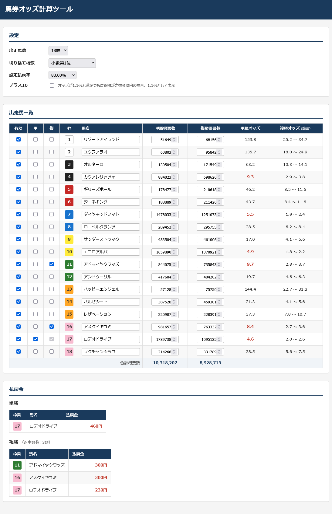

# 馬券オッズ計算ツール

単勝・複勝のオッズと払戻金を計算するWebアプリです。  
[こちら](https://strangerxxxx.github.io/odds-calculator/)から利用できます。  
コードは[Kiro](https://kiro.dev/)にて生成しました。



## 機能

- **単勝オッズ計算** — 各馬の得票数から単勝オッズを算出し、10倍未満を赤太字で強調表示
- **複勝オッズ計算** — 的中頭数に応じた複勝オッズの範囲（最小〜最大）を表示
- **払戻金表示** — 単勝・複勝チェックを入れた馬の払戻金を円単位で表示
- **プラス10** — オッズが1.1倍未満かつ払戻総額が売得金以内の場合、1.1倍として表示

## 設定項目

| 項目         | 説明                                   |
| ------------ | -------------------------------------- |
| 出走馬数     | 2〜29頭                                |
| 切り捨て桁数 | 整数〜小数第9位                        |
| 設定払戻率   | 70〜100%のプリセット、またはカスタム値 |
| プラス10     | 最低払戻保証の適用切替                 |

## 技術スタック

- [React 19](https://react.dev/)
- [TypeScript](https://www.typescriptlang.org/)
- [Vite](https://vite.dev/)
- [oxlint](https://oxc.rs/docs/guide/usage/linter)

## 開発環境のセットアップ

```bash
npm install
npm run dev
```

## ビルド

```bash
npm run build
```

ビルド成果物は `dist/` に出力されます。

## ライセンス

MIT
